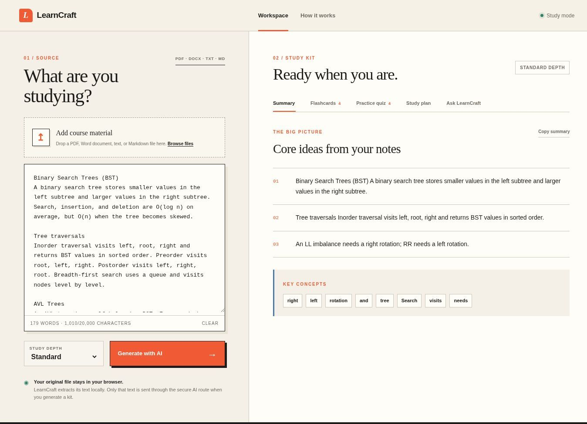
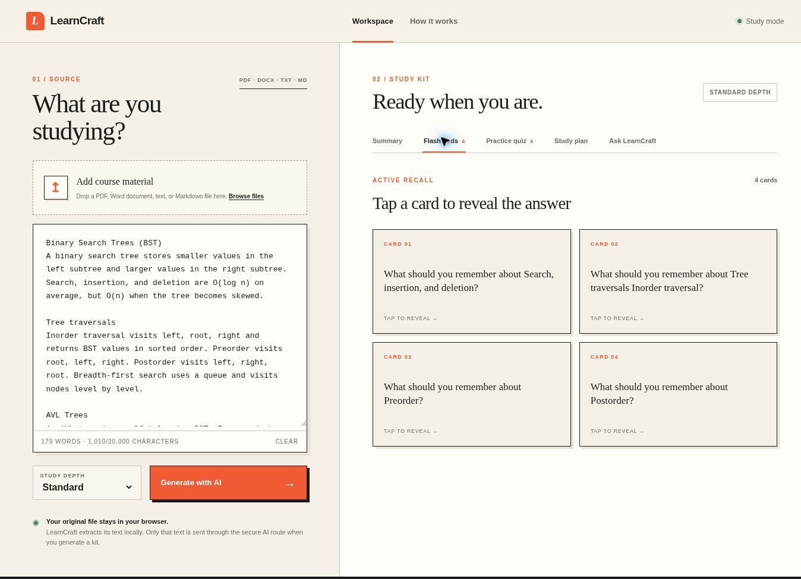
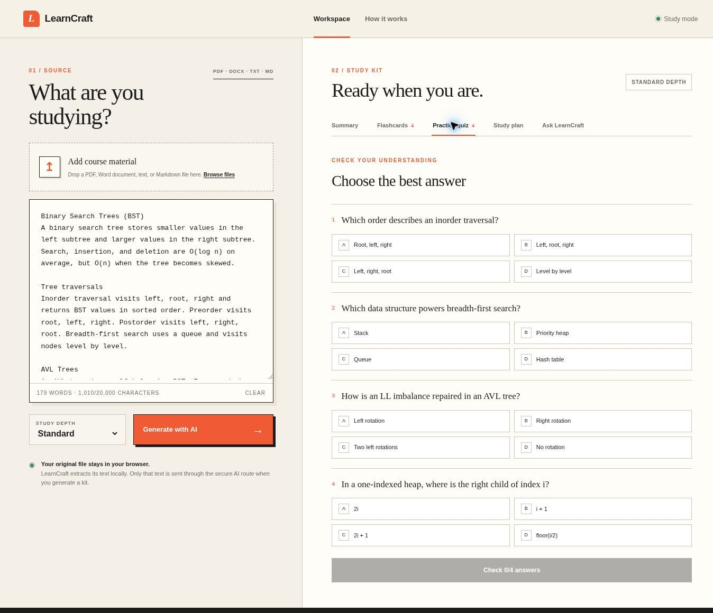

# LearnCraft

LearnCraft is an AI-powered study assistant that turns class notes and course documents into summaries, key concepts, flashcards, practice quizzes, study plans, and source-grounded answers.

**Live demo:** [learncraft-study.vercel.app](https://learncraft-study.vercel.app)



## How it works

1. **Add course material** — upload a PDF, DOCX, TXT, or Markdown file, or paste notes directly into the workspace.
2. **Choose a study depth** — select Quick, Standard, or Deep depending on how much detail you need.
3. **Generate a study kit** — LearnCraft sends the notes to a protected server-side API route and returns structured learning material.
4. **Study actively** — move between the Summary, Flashcards, Practice Quiz, Study Plan, and Ask LearnCraft tabs.

### Flashcards



### Practice quiz



## Features

- PDF, DOCX, TXT, Markdown, and pasted-text input
- AI-generated summaries and key concepts
- Active-recall flashcards
- Multiple-choice quizzes with explanations
- Focused 30-minute study plans
- Source-grounded document chat
- Quick, Standard, and Deep generation modes
- Responsive, keyboard-friendly interface
- Local document text extraction before AI processing
- Automatic local fallback if AI generation is unavailable

## Tech stack

- **Frontend:** Next.js, React, TypeScript, Tailwind CSS
- **AI:** OpenAI Responses API with structured JSON output
- **Document processing:** PDF.js and Mammoth
- **Deployment:** Vercel

## Security and reliability

- The OpenAI API key is stored only in server-side environment variables.
- AI endpoints enforce same-origin JSON requests and request-size limits.
- Public-demo rate limits reduce automated abuse and unexpected API usage.
- AI responses are not cached and are requested with storage disabled.
- Uploaded document text is extracted locally and can be reviewed before generation.

## Run locally

Requirements: Node.js 22 or newer and an OpenAI API key.

```bash
npm install
cp .env.example .env.local
npm run dev
```

Add the following values to `.env.local`:

```env
OPENAI_API_KEY=your_api_key_here
OPENAI_MODEL=gpt-5.4-mini
```

Open [http://localhost:3000](http://localhost:3000). Never commit `.env.local` or expose the API key through a `NEXT_PUBLIC_` variable.

## Deploy to Vercel

1. Import the GitHub repository into Vercel.
2. Add `OPENAI_API_KEY` and `OPENAI_MODEL` under Environment Variables.
3. Deploy the project as a Next.js application.

## Author

Made by Nathaniel Ibemesim · 2026
